# Course Waitlist Class Diagram

```mermaid
classDiagram
    direction TB

    class RegistrationUseCase {
        <<interface>>
        +enroll(offeringId, request) EnrollmentResult
        +drop(offeringId, learnerId) DropResult
        +getOffering(offeringId) OfferingSnapshot
    }

    class CourseAdministrationUseCase {
        <<interface>>
        +updateOffering(offeringId, request) CourseUpdateResult
    }

    class OfferingInitializationUseCase {
        <<interface>>
        +initializeDefaultOffering(offering)
    }

    class RegistrationController {
        -RegistrationUseCase registrationUseCase
        +enroll(offeringId, request) EnrollmentResult
        +drop(offeringId, learnerId) DropResult
        +getOffering(offeringId) OfferingSnapshot
    }

    class AdminController {
        -CourseAdministrationUseCase administrationUseCase
        +updateOffering(offeringId, request) CourseUpdateResult
    }

    class DefaultOfferingInitializer {
        -OfferingInitializationUseCase initializationUseCase
        -DefaultOfferingProperties properties
        +initialize()
    }

    class RegistrationService {
        -Logger logger
        -ReentrantLock operationLock
        -RegistrationRepository repository
        -EligibilityPolicy eligibilityPolicy
        +initializeDefaultOffering(offering)
        +enroll(offeringId, request) EnrollmentResult
        +drop(offeringId, learnerId) DropResult
        +getOffering(offeringId) OfferingSnapshot
        +updateOffering(offeringId, request) CourseUpdateResult
        -promoteEligibleLearners(offeringId) PromotionResult
    }

    class RegistrationRepository {
        <<interface>>
        +findOffering(offeringId) Optional
        +saveOffering(offering)
        +findLearner(learnerId) Optional
        +saveLearner(learner)
        +isEnrolled(offeringId, learnerId) boolean
        +isWaitlisted(offeringId, learnerId) boolean
        +enrollmentCount(offeringId) int
        +addEnrollment(offeringId, learnerId)
        +removeEnrollment(offeringId, learnerId) boolean
        +enqueue(offeringId, learnerId) int
        +pollWaitlist(offeringId) Optional
        +snapshot(offeringId) RegistrationStateSnapshot
    }

    class InMemoryRegistrationRepository {
        -HashMap~String,CourseOffering~ offerings
        -HashMap~String,Learner~ learners
        -Map~String,Set~ enrollments
        -Map~String,ArrayDeque~ waitlists
        -Map~String,Set~ waitlistMembership
    }

    class EligibilityPolicy {
        <<interface>>
        +isEligible(learner, offering) boolean
    }

    class AllPrerequisitesEligibilityPolicy {
        +isEligible(learner, offering) boolean
    }

    class CourseOffering {
        <<immutable record>>
        +String offeringId
        +String courseId
        +int capacity
        +Set~String~ prerequisiteCourseIds
    }

    class Learner {
        <<immutable record>>
        +String learnerId
        +Set~String~ completedCourseIds
    }

    class DefaultOfferingProperties {
        <<immutable configuration>>
        +String offeringId
        +String courseId
        +int capacity
        +Set~String~ prerequisiteCourseIds
    }

    class EnrollmentRequest {
        <<immutable record>>
        +String learnerId
        +Set~String~ completedCourseIds
    }

    class UpdateOfferingRequest {
        <<immutable record>>
        +String courseId
        +int capacity
        +Set~String~ prerequisiteCourseIds
    }

    class EnrollmentResult {
        <<immutable record>>
        +EnrollmentOutcome outcome
        +String learnerId
        +Integer waitlistPosition
    }

    class DropResult {
        <<immutable record>>
        +String droppedLearnerId
        +List~String~ promotedLearnerIds
        +List~String~ skippedLearnerIds
    }

    class CourseUpdateResult {
        <<immutable record>>
        +OfferingSnapshot offering
        +List~String~ promotedLearnerIds
        +List~String~ skippedLearnerIds
    }

    class PromotionResult {
        <<immutable record>>
        +List~String~ promotedLearnerIds
        +List~String~ skippedLearnerIds
    }

    class OfferingSnapshot {
        <<immutable record>>
        +CourseOffering offering
        +Set~String~ enrolledLearnerIds
        +List~String~ waitlist
    }

    class RegistrationStateSnapshot {
        <<immutable record>>
        +Set~String~ enrolledLearnerIds
        +List~String~ waitlist
    }

    class EnrollmentOutcome {
        <<enumeration>>
        ENROLLED
        WAITLISTED
    }

    class RegistrationException {
        +ErrorCode code
        +String message
    }

    class ErrorCode {
        <<enumeration>>
        ALREADY_ENROLLED
        ALREADY_WAITLISTED
        INELIGIBLE
        LEARNER_NOT_FOUND
        OFFERING_NOT_FOUND
        NOT_ENROLLED
        INVALID_CAPACITY
    }

    class GlobalExceptionHandler {
        -Logger logger
        +handleRegistrationException(exception) ApiError
        +handleValidationException(exception) ApiError
    }

    class ApiError {
        <<immutable record>>
        +String code
        +String message
        +Instant timestamp
    }

    RegistrationController --> RegistrationUseCase
    AdminController --> CourseAdministrationUseCase
    DefaultOfferingInitializer --> OfferingInitializationUseCase
    DefaultOfferingInitializer --> DefaultOfferingProperties

    RegistrationService ..|> RegistrationUseCase
    RegistrationService ..|> CourseAdministrationUseCase
    RegistrationService ..|> OfferingInitializationUseCase
    RegistrationService --> RegistrationRepository
    RegistrationService --> EligibilityPolicy

    InMemoryRegistrationRepository ..|> RegistrationRepository
    InMemoryRegistrationRepository o-- CourseOffering
    InMemoryRegistrationRepository o-- Learner

    AllPrerequisitesEligibilityPolicy ..|> EligibilityPolicy
    AllPrerequisitesEligibilityPolicy --> CourseOffering
    AllPrerequisitesEligibilityPolicy --> Learner

    RegistrationController ..> EnrollmentRequest
    RegistrationController ..> EnrollmentResult
    RegistrationController ..> DropResult
    AdminController ..> UpdateOfferingRequest
    AdminController ..> CourseUpdateResult

    RegistrationService ..> PromotionResult
    RegistrationService ..> OfferingSnapshot
    RegistrationRepository ..> RegistrationStateSnapshot

    EnrollmentResult --> EnrollmentOutcome
    RegistrationException --> ErrorCode
    GlobalExceptionHandler --> RegistrationException
    GlobalExceptionHandler ..> ApiError

    note for RegistrationController "Base path: /api/v1/offerings"
    note for AdminController "Base path: /api/v1/admin/offerings"
    note for RegistrationService "Owns the fair lock and executes each compound workflow atomically"
    note for InMemoryRegistrationRepository "Private collections accessed only while the service lock is held"
    note for CourseOffering "No setters; collection values use defensive immutable copies"
    note for Learner "No setters; collection values use defensive immutable copies"
```

## Implementation constraints

- `RegistrationService` is the only concurrency coordinator.
- Every repository call in a compound workflow executes while the service's fair
  `ReentrantLock` is held.
- `InMemoryRegistrationRepository` does not expose its mutable maps, sets, or
  deques.
- Domain models, DTOs, and snapshots are immutable records with defensive
  collection copies.
- The application loads one default offering at startup and exposes no
  course-creation API.
- Source packages follow the conventional `controller`, `service`, `repository`,
  `model`, `dto`, `exception`, and `config` structure.
- Application code logs through SLF4J with Log4j2 as the runtime backend.
- Logs cover startup, enrollment, waitlisting, drops, promotion, course updates,
  and rejected requests without recording completed-course collections.
